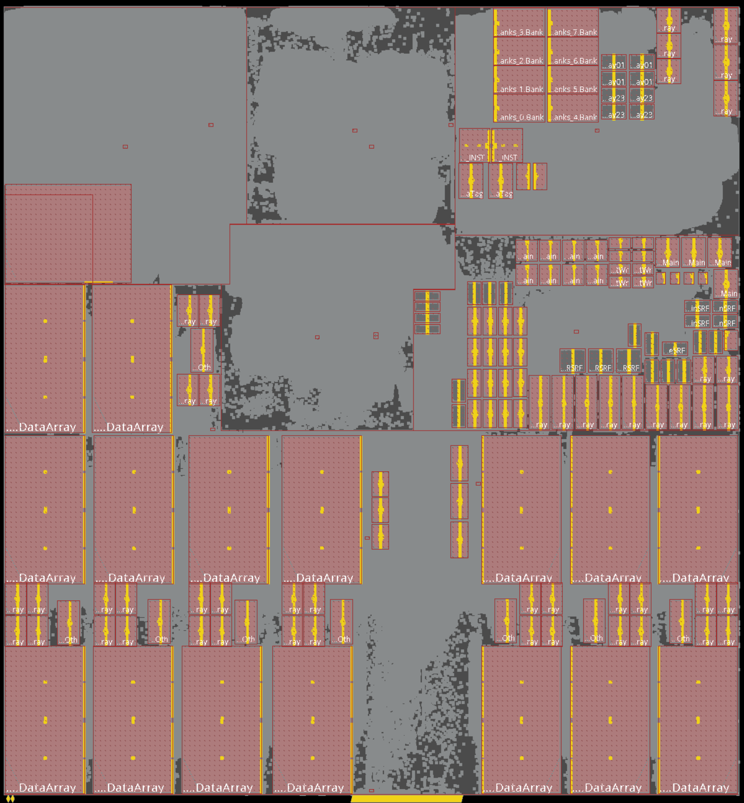

# Panthera: Ampere's CPU Performance Model

Panthera is the cycle-accurate software performance model built by Ampere's
Architecture & Performance team to study prospective CPU features, evaluate
microarchitectural tradeoffs, and guide the development of our
high-performance cloud processors.

See the [User Guide](doc/UserGuide.md) for information about building and using
Panthera and its associated tooling.

## Why We Open-Sourced Panthera

Historically, industrial-grade performance models calibrated against
production silicon have remained closely guarded trade secrets. We decided to
open-source Panthera because we believe the broader computer systems and
architecture community stands to benefit immensely from having access to a
modern, commercial-caliber modeling infrastructure. Because AmpereOne is
actively deployed and accessible across major cloud providers, researchers
now have an unprecedented opportunity to study, experiment with, and directly
correlate a software model against real, production silicon running in the
cloud.

Here is why we are opening Panthera to the world:

### 1. Correlating Models to Real Silicon
For decades, academic computer architecture research and graduate education
have relied heavily on academic simulators. While foundational, these tools
often diverge from the complex realities and trade-offs of commercial server
processors.

Panthera bridges this divide by providing an industrial-strength performance
model developed for designing CPU products. Because Ampere processors are
widely available in the public cloud, researchers, educators, and
practitioners can run workloads on both this model and actual production
silicon. This enables the community to validate ideas against realistic
microarchitectural baselines, evaluate concepts in an authentic server
context, and separate the architectural "wheat from the chaff."

### 2. Sharing Real-World Architectural Craftsmanship
Panthera was built from scratch by CPU architects
bringing decades of experience from across the semiconductor industry. The
modeling abstractions reflect practical lessons learned while building
high-performance CPUs.  By sharing this infrastructure alongside our
companion tools like [catscan](https://github.com/AmpereComputing/catscan),
we aim to foster open collaboration across industry and academia, planting
the seeds for better modeling practices and novel microarchitectural ideas.

### 3. "Low-Background Steel" in the AI Era
*Low-background steel* refers to steel forged before atmospheric nuclear
testing, free of background radiation and prized as a baseline for
sensitive scientific instruments.

In that same spirit, Panthera represents low-background steel for computer
systems. It is an end-to-end, industrial-grade performance model conceived,
designed, and hand-crafted entirely by human architects before the era of
generative AI. This repository represents over 8 years of work and 6000
individual git commits by 45 people. By making this human-authored codebase
public, we hope it serves as a trusted, high-watermark reference for human
engineers and future automated hardware-modeling tools alike.

### Project Status & Community Use
Panthera is released as a public **reference implementation** under a
permissive open-source license. While Ampere does not provide commercial
support or active feature roadmaps for this public repository, we actively
welcome the community to explore the codebase, adapt it for research, and
fork it for novel architectural exploration.

## Products and Microarchitecture

### Secret Decoder Ring

Configuration files in the repository use code names for the SoC product and
the custom cores within them. Here is a quick decoder ring between the
external marketing names and the engineering names.

| Product | SoC name | Core name |
|---|---|---|
| AmpereOne | Siryn | Furiosa |
| AmpereOne X | Banshee | Ripley |
| AmpereOne MX | Rogue | Trinity |
| AmpereOne Aurora | Domino | Connor |
| AmpereOne Next | Nebula | Alita |

### Furiosa

Panthera models several generations of Ampere processors. The AmpereOne (Siryn)
model configuration contains our original custom core designed for high
performance and low-power cloud computing: Furiosa. The [Furiosa
microarchitecture notes](doc/design/furiosa.md) describe it in more detail.

  

### Later Generations

The [product floorplan gallery](doc/design/floorplans.md) maps the floorplans
for AmpereOne, AmpereOne X, AmpereOne MX, and AmpereOne Aurora to their SoC and
core code names. Each of these cores builds upon the previous
micro-architecture. Likewise, our model uses 'delta' configurations which build
upon the previous generation's.
