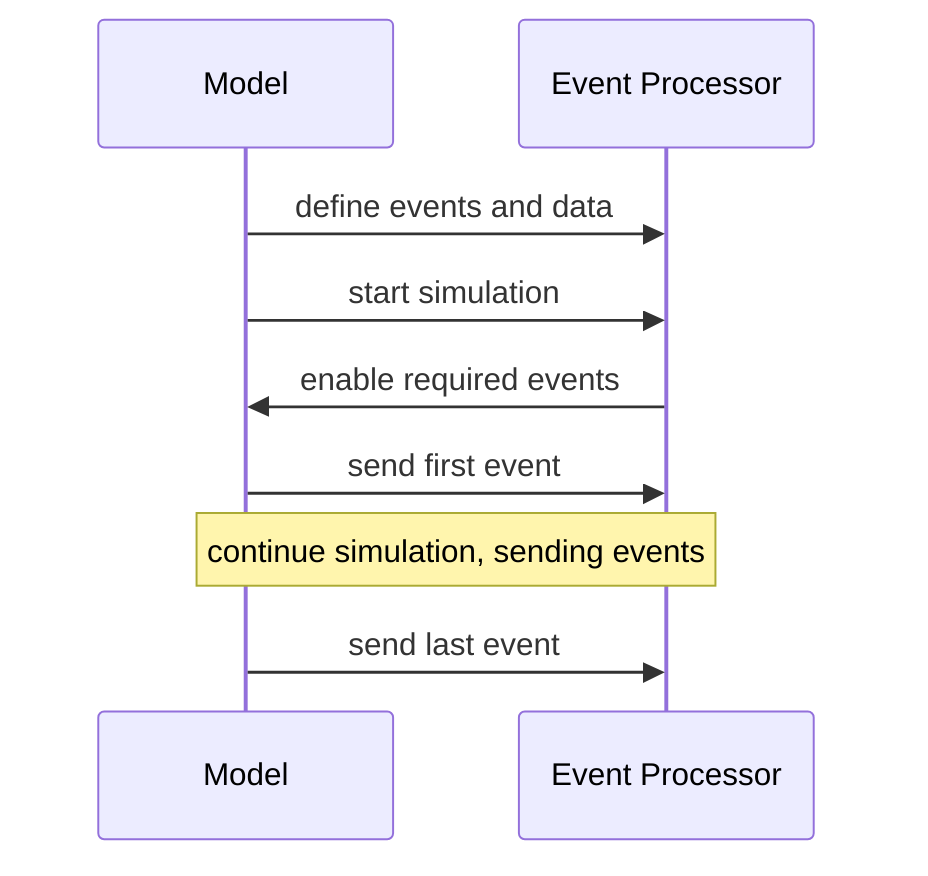

# Event Processing

When we run a simulation, we want to measure different kinds of things.
For example, we might want to:

- Count when something happens: how many times did we miss the cache?
- Know the time between two things happening: what is the latency between
  sending a request and getting a response?
- Track some particular state over time: how full is the transmit queue
  throughout this workload?

To collect this kind of information in Panthera we have separated a
simulation into two parts: the _model_, and the _event processor_. In
the model, there is only the concept of an _event_. An event is simply
the model announcing that _some particular thing happened_ at a point
in time. This keeps the model code relatively simple and uniform. There
is no need for custom built stat counters, histograms, occupancy trackers,
and so forth, to be written into the model. Instead the model announces
events "into the ether" and a second tool takes care of turning those
events into useful data. That second tool is the _event processor_.

This document does not cover how to write events in the model. Suffice
to say that they are essentially function calls that carry a time stamp
and an arbitrary amount of auxiliary data.

(Auxiliary data is fundamental to processing events. Think of the case
where you have an event for a branch misprediction, but you want to count
mispredictions separately by branch type; or you have an event when a
request is sent but you want to know how many were sent with a particular
opcode. In these cases, the branch type and the opcode would be essential
bits of data to include with the event.)

The job of the event processor, then, is to receive events from the model
and count them, decompose them, filter them, measure time between them,
etc. In fact all the possible ways you might want to process events is
not fixed. With that it mind, the event processor is built with a
_plug in_ architecture, so that it can be easily extended. And so that it
can applied efficiently&mdash;the processing that needs to happen while debugging
the core model on a single trace might look very different than what needs
to happen while building a projection of a workload over hundreds of traces.

## Anatomy of a Simulation

At a high level, a simulation run with `panthera sim` is two communicating
processes:



Mostly the communication is one way: the model sending events to the event
processor as the simulation proceeds. Before simulation begins, however, notice
that it is the _processor_ that is responsible for enabling events. This is so
that the user can make a decision once place---what data do I want to see?---and
the simulation will arrange to make it happen. There is no need to separately
configure the simulator and event processor to work together.

## Event Processor Plugins

Because there are so many different ways to look at events, the event processor is
built with a flexible _plug in_ architecture. Here are some of the available
plugins and a brief description of what each does.

### Capturing Plugins

These plugins can alter/filter the event-stream and output to new ES file or stdout (in ES format).

<table>
<tr>
  <th>Plugin</th>
  <th>Description</th>
</tr>
<tr>
  <td><code>capture</code></td>
  <td>Save events to an event stream (protobuf) file. Can effectively by used to filter
      for events or time ranges</td>
</tr>
<tr>
  <td><code>time_skip</code></td>
  <td>Capture and adjust time when skipping events</td>
</tr>
</table>

### Reporting Plugins

These plugins aggregate and report their output to a separate file (e.g. CSV) or emit info to stdout.

<table>
<tr>
  <th>Plugin</th>
  <th>Description</th>
</tr>
<tr>
  <td><code>count</code></td>
  <td>Count events, optionally factoring counts by data values. The workhorse plugin.</td>
</tr>
<tr>
  <td><code>param</code></td>
  <td>Report parameter values from the model run.</td>
</tr>
<tr>
  <td><code>latency</code></td>
  <td>Measure latency between a sequence of events (currently just pairs).</td>
</tr>
<tr>
  <td><code>rate</code></td>
  <td>Collect a histogram of event occurrences within some time/event region.</td>
</tr>
<tr>
  <td><code>ls</code></td>
  <td>List defined events and/or data values. A sort-of table of contents for event streams.</td>
</tr>
<tr>
  <td><code>print</code></td>
  <td>Print raw events. Mainly used for debug.</td>
</tr>
<tr>
  <td><code>python</code></td>
  <td>Allow processing events with an embedded Python interpreter.</td>
</tr>
<tr>
  <td><code>rename</code></td>
  <td>Rename or copy events. This is most useful for taking metrics with long, awkward factored
      names and giving them readable names.</td>
</tr>
<tr>
  <td><code>sum</code></td>
  <td>Add up metrics which match a pattern, and give the sum a new name.</td>
</tr>
<tr>
  <td><code>summarize</code></td>
  <td>The primary way to produce outputs: summary and timeseries CSV files.</td>
</tr>
</table>

## Event Processor Arguments

The organization of event processor arguments is the same whether you are
running it as part of a simulation, or by itself on the command line (i.e.,
on a previously captured event stream file). The general schema for
arguments is:

    [<global args>...] [+<plugin> [-<plugin arg>...]] [+<plugin> [-<plugin arg>...]]

or alternatively:

    [<global args>...] [-P <plugin> [-<plugin arg>...]] [-P <plugin> [-<plugin arg>...]]

In other words, arguments to the event stream processor as a whole come
first. Then a plugin name is introduced, either with "-P <plugin>" or just
"+plugin". Subsequent arguments, starting with "-", will be passed to that plugin,
up to the next plugin name, or the end of the argument list. It is possible
to invoke the same plugin more than once. This will create a separate
"instance" of the plugin with different arguments.

The event processor tends to require a lot of arguments. It's useful to organize
them into files. To make this easier, the event processor will interpret any
string beginning with "@" on the command line or in config files to be a file
name, and will then read the "words" in that file as if they had been passed on
the command line. Examples:

    % evp @/full/path/to/file.cfg
    % evp +count @my_counts.cfg +summarize

If a file does not exist with the path given, the event processor will look
in install/config/event.processor to try to find it. So, given:

    % evp @installed_defaults.cfg

If the file "installed_defaults.cfg" exists in the current directory, it
will be used, but otherwise the processor will try to find
"install/config/event.processor/installed_defaults.cfg".

When configs are referenced *within* other configs, the search will instead
start relative to the config file it's within. For instance, if
`@./configs/something.cfg` references `@base.cfg` inside. It will first check
`./configs/base.cfg` and then `install/config/event.processor/base.cfg`. Note,
if `./` or `../` is explicitly used in the path, it will *only* check for config
files relative to the parent config (not install path).


### Global Options

    evp [--es <event stream file>] [-i <interval>] [--start <trigger>] [--stop <trigger>] [--exit]

To run the event stream processor on a file (e.g. from a previous capture),
use the `--es` option. See the `capture` plugin description for how to create
an event stream file.

To collect metrics throughout time, rather than just at the end, use the
interval option (`-i`) to specify a collection interval. The collection
interval can be a time value (a number followed by one of the suffixes:
"ps", "ns", "us", "ms", "s"), or it can be a metric and a value
(`<metric name>=<count>`). The former case simply collects periodically
when the desired time boundary has been crossed. The latter will collect
each `<count>` occurrences of the metric. A collection interval cannot
currently use a factored metric. See the `summarize` plugin for the
means to capture the collected timeseries of metrics.

To collect metrics through some region of time/values, you can specify
`--start` and/or `--stop`, see _triggers_ below.

The `--exit` switch tells the event processor to exit after the `--stop` trigger
has been reached. This is useful in cases where you don't wish to wait until the
end of normal simulation to stop the model run (i.e. you're collecting some data
for debug and don't care about events past the region of interest).

#### Start/Stop Triggers

A trigger is either a time value, or the value of a particular metric that can
be used in `--start` or `--stop`. When the metric reaches the value, the trigger
is activated. Examples:

Start processing after 10 microseconds (stop at the end of simulation):

    evp --start 10us

Stop processing after 10,000 instructions have been committed:

    evp --stop core.instruction_commit=10000

Start processing after the 5th read has been sent, and stop at 1 millisecond:

    evp --start send_read=5 --stop 1ms

Note, that these values are relative to the beginning of the stream that `evp`
*sees*. Thus without adding `-event_stream_always true`, counts will be relative
to *after* warmup.

Times are absolute time, not relative times (so explicitly the last example
does _not_ stop 1 millisecond after the start, it stops when 1 millisecond
has been reached).

Currently it is not possible to trigger on factored events.

### Patterns

Event specifications can include glob-like patterns. Where:

* `#`: matches one number
* `*`: matches zero-or-more characters (including `.`)
* `?`: matches one-or-more characters (excluding `.`)
* `[...]`: matches a range of characters (regex-like)
* `[!...]`: matches a *negated* range of characters

### Chaining/Filtering

`evp` can be used to filter/adjust streams and pipe that into subsequent calls
of `evp`. For example:

    evp +count -e 'cache.lookup' +capture - | evp +count -a +print

The above will only capture the `cache.lookup` event and emit a new stream to
stdout (indicated by `-`) which the next `evp` processes and prints.

In this manner, you can can filter/adjust streams and to later reporting on the
adjusted stream.

## Plugin Synopses

### count

#### Arguments

    +count [-a] [--no-enum] [--list] [-e <event specification>] [--accumulate <event data>]...

Examples:

```sh
+count -a                            # count all events
+count -e cache.lookup               # count cache lookups
+count -e cache.lookup/hit           # count cache lookups factored by the "hit" data item
+count -e cache.lookup/hit:1         # count cache lookups by "hit" with value 1
+count -e cache.lookup/hit:[0:16:2]  # count cache lookups by "hit", adjusting values to a
                                     # minimum of 0, maximum of 16, and granularity of 2
+count --accumulate mem_resp/latency # accumulate total value of mem_resp/latency
```

#### Description

The `count` plugin provides the basic means of counting events. You can also
"factor" events on data items and count those factors individually. What this
means is that if you have an event, for example, `cache.lookup` and it is posted
with a data item called `hit` which has a value of 0 or 1, then you can separate
the counts where hit is 0 and hit is 1 by specifying `cache.lookup/hit`. The
resulting metrics will have the names `cache.lookup/hit:0` and `cache.lookup/hit:1`
(though see the `rename` plugin for how to change these names).

It is common to have event and data items declared as siblings in the same module
scope. For example, `cache.lookup` might be the full event name, and `cache.hit`
might be the data name. If you want to use `hit` as a factor, you can still refer
to this as `cache.lookup/hit`. The processor will first try to find `hit` in the
same scope as `lookup` (that is, it will prepend the `cache.` automatically). If
that fails, it will try to find `hit` as a global data name. If you need to _force_
`hit` to be a global name, due to a name conflict, you can prepend a '.' like this:
`cache.lookup/.hit`.

An event may have any number of factors: `event/data1/data2/...`. The counts will
be split up into all combinations. It is possible to see in the output a metric
name which does not include all data items. This happens if the event is posted
without that data item on at least one occasion. The base event (total) count is
also always included.

Data factors must have integer types to be used as factors today. There is no
factoring on strings or floating point data.

Values can be restricted either by:

* `-e */factor_name:value`: counts only events where `factor_name = value`
* `-e */factor_name[min:max:granularity:sequence]`: adjusts factor value into a "histogram" format where:
  * `min`: minimum value emitted, any values *below* this will be set to `min`
  * `max`: maximum value emitted, any values *above* this will be set to `max`
  * `granularity`: granularity of value emitted (depends on `sequence`)
  * `sequence`: how the granularity is used, either:
    * `linear` (default): linear sequence of granularity. For example values `1,2,3,4` with a
      granularity of `2` would become `0,2,2,4`
    * `exp|exponential`: exponential sequence, where granularity is the base. For example values
      `1,3,5,10` with a granularity of `2` would become `1,2,4,8`
    for example values `1,2,3,4` with a granularity of `2` would become `0,2,2,4`
  * **Note**: any of these values can be left out, but `:` must remain. For example, `[::2]` would set only granularity to `2` (min and max would not be applied)

Data values can be accumulated into a single, total metric using `--accumulate` which
will accumulate the total for the data-values specified (as opposed to counting each
factor separately like `-e`).

`--list` is useful for verifying that you will be counting the events/factors
you expect given the config or arguments specified.  Unlike `+ls` it will only
emit names for events/factors that will be counted.

### capture

#### Arguments

    +capture <output filename> [-f|--force] [--filter <filter spec>]

#### Description

The `capture` plugin saves event stream data into a file (or stdout with `-`).
It will only capture events that other plugins are "paying attention
to"&mdash;the philosophy here is that if you add `capture` to a command line,
the file it saves should allow you to rerun the same command line with that file
as input and produce the same metrics as before. Thus can think of `capture` as
a kind of filter (of course you can always capture all events with `+count -a`
along with the capture).

##### Filters

It is possible to only capture events which satisfy a _filter_. A filter is a
value for a particular data item. This can be useful in very long runs where
you only want to capture, say, a single transaction. In that case you would
write something like this:

    +capture tx_1234.es --filter txid=1234

The format of a filter specification is `<data_name>=<data_value>`.

### latency

#### Arguments

    +latency
      [-n|--name <name>]
      [-p|--prefix <prefix>]
      [-k|--key <key>...]
      [--histogram]
      [--factored]
      <start event> <stop event> ...

#### Description

The `latency` plugin measures the time between pairs of events that belong to
the same transaction (i.e., they have the same `txid` data item) or same key
value (if provided). Latencies are aggregated and reported as a pair of metrics,
the "count" (how many times the pair was seen) and the "total" (the sum of all
the time between events in picoseconds).

There some additional rules to how latencies are collected:

1. If a transaction has no start event, or no stop event, it is not counted.
2. Each time the start event appears, latency measurement begins anew. This
   implies that if a start/stop pair appears more than once in a transaction,
   both will be counted. But it also means that if two start events appear
   without an intervening stop event, the first start event will be discarded
   (it is treated as if it was "missing" the stop event).
3. It's perfectly fine if the start and stop events are posted at the same
   time. They will count as an occurrence with a zero latency.

The `--name` option allows you to provide a metric name for the results. If
you don't provide a name, one will be constructed by concatenating the names
of the start and stop events with an "_" in between. Note that this can lead
to some pretty awkward names, especially if event patterns are involved; hence
the option to rename.

You may also provide a prefix with `--prefix` that will be applied to both
the start and stop event with an intervening ".". This isn't all that useful
today, but will be more so when `latency` is expanded to allow for a chain
of events.

If `--histogram` is provided, a histogram of latencies will be emitted in the
format of `{name}.{histogram_name}.{latency}` or `{name}/{histogram_name}:{latency}`
if `--factored`. Also, similar to `+count`, `--histogram` can be used with a
"histogram-format" like `--histogram name[min:max:granularity:sequence]`, which
adjusts the `<latency>` value where:

  * `min`: minimum value emitted, any values *below* this will be set to `min`
  * `max`: maximum value emitted, any values *above* this will be set to `max`
  * `granularity`: granularity of value emitted (depends on `sequence`)
  * `sequence`: how the granularity is used
  * *See +count for more information*

Examples:

Measure the latency between event `a` and event `b`:

    +latency a b

This could result in metrics like:

    a.count       100
    a.max_latency 143
    a.min_latency 32
    a.stdev       52
    a.sum_latency 7324

You can compute the average latency by dividing `sum_latency` by `count`.

Measure the latency between `foo.a` and `foo.b`, and call it `lat`:

    +latency --prefix foo -n lat a b

This will give you output metrics like `lat.*`.

For a histogram use:

    +latency --histogram latency a b

Which could result in metrics like:

    a.count       100
    a.latency.32  3
    a.latency.36  2
    ...
    a.latency.143  1
    a.max_latency 143
    a.min_latency 32
    a.stdev       52
    a.sum_latency 7324

### rate

#### Arguments

    +rate <interval> [--factored] [-n|--name <name>] [-e|--event <event>]...

#### Description

The `rate` counts occurrences of events (added with `--event`) within the interval
(time or event, like `-i`). These emitted events are named either:

* Non-factored: `<event_name>.<name>.<rate>`
* Factored: `<event_name>/<name>:<rate>`

Where "rate" is the default name. `--name` and `--event` can be intermixed within the
same definition to provide different names to different events.

Also, similar to `+count`, `-e/--event` can be used with a "histogram-format" like
`-e event_name[min:max:granularity:sequence]`, which adjusts the `<rate>` value where:

  * `min`: minimum value emitted, any values *below* this will be set to `min`
  * `max`: maximum value emitted, any values *above* this will be set to `max`
  * `granularity`: granularity of value emitted (depends on `sequence`)
  * `sequence`: how the granularity is used
  * *See +count for more information*

Examples:

Count load dispatches per-cycle:

    +rate core.gpc.cycle -e lsu.uop_ld_execute

Which would emit something like:

    lsu.uop_ld_execute.0 2143
    lsu.uop_ld_execute.1 1429
    lsu.uop_ld_execute.2 1224

### rename

#### Arguments

    +rename
      [-r <old name>=<new name>]...
      [-c <old name>=<new name>]...
      [-rl <old name>=<new name>]...
      [-cl <old name>=<new name>]...

The `rename` plugin can rename (`-r`), copy (`-c`), lowercase-rename (`-rl`), or
lowercase-copy (`-cl`) metrics from one name to another. It does not effect the
processing of events in any way, it merely updates the metric table before
results are printed.

The old name can be a pattern expression, and so the new name can use back references
to refer to captures in that pattern (in fact even the old name itself can make use
of back references, which is often useful for factored metrics).

Examples:

Count cache hits (with a factored data item) and rename the result:


    +count -e *.access/hit
    +rename -r (*).access/\1.hit:1=$1.hit


Now the metric `core.cache.access/core.cache.hit:1` will be output as `core.cache.hit`.

You must count the event to rename it.  If you are factoring based on
a data item, you must count that factored event explicitly, as the
example above shows.

The copy option is just like rename except that it doesn't replace the old metric
in the metric table, so both will be output.

The lowercase option is just like rename except the final string is converted to
lowercase, which is useful for enumeration-factors.

### sum

#### Arguments

    +sum <pattern>=<new name>...

The `sum` plugin is similar to rename, except that it _must_ take a pattern as
the old name. It will then add up the metric values that match the pattern and
output them as a new metric.

Examples:

Add up all the TLB lookups regardless of where they happened:

    +sum *.tlb.lookup=tlb_lookups

Add up the count of different branch types (e.g., all the conditional branches).
You would have to know in advance what numeric value the branch types have.

    +count -e *.commit/branch_type:*
    +sum (*).commit/branch_type:[123]=$1.conditional_branches
         (*).commit/branch_tyoe:[456]=$1.unconditional_branches

### summarize

#### Arguments

    +summarize [--timeseries <name>] [--summary <name>]

The `summarize` plugin is the primary way to output metrics. By default, with
no arguments, it will print a table of metrics values to standard out. If the
`--summary` option is supplied, then those metrics will instead be printed to
the given file, in CSV format.

Additionally, `--timeseries` allows you to print metrics collected at the
collection interval to a CSV file. This file has the same metrics as the summary,
but it has many rows, one for each collection interval (`start_time` and
`stop_time` indicate the interval).

Typically we would name a summary file with the suffix `.summary.csv` and
the timeseries with `.ts.csv`, but that's just a convention.

### time_skip

#### Arguments

    +time_skip <output filename> [-f|--force] [--event <event>]

The `time_skip` plugin can skip over an event while adjusting all subsequent
events for the time taken by that event.

#### Examples

    +time_skip - --event clock_skip

Whenever there's a `clock_skip` event, that and all subsequent events for _that_
time are skipped. For all events _after_ that time, their time is adjusted
(subtracted) by the time that has been skipped so far.

### ls

    +ls [--events] [--values] [--enum <value name>]...

The `ls` plugin is used with event stream files to see the "index" of events
or data values defined in the file. By default (or with `--events`) it will
list event definitions. With `--values` it will show data value definitions.
Or with both it will show all definitions. With `--enum <name>` it will show
the enumeration values (integer and strings) for the specified value names.

If you run an event processor command line and a pattern doesn't match as
you expected, the `ls` plugin can be very handy to see what's actually in
the file.

### print

    +print [--no-enum]

The `print` plugin is mostly for debugging. It will print the raw events with
their timestamps and data (i.e., an ASCII version of the file contents). Like
`capture`, it only prints events that are being examined by any plugin. This
is very useful to limit what's printed, but can be confusing if you try to
use `print` alone on the command line and get no output.

Examples:

Print all events:

    +count -a +print

Print any send and receive event:

    +count -e *.send -e *.recv +print

### python

    +python <python file> [arguments]

Or for multiple python plugins:

    +python <python file1> [arguments1] +python <python file2> [arguments2] ...

The `python` plugin allows processing of events with an embedded Python
interpreter.

You supply a Python file and optionally arguments to the plugin. Inside a Python
file, importing the `evp` package will allow interaction with the event
processor. `evp` contains the following functions:

<table>
<tr>
  <th>Signature</th>
  <th>Description</th>
</tr>
<tr>
  <td><code>on(event_spec: str, func: callable)</code></td>
  <td>Schedule a function to run when a matching event occurs, like <code>func(event: Event) -> None</code></td>
</tr>
<tr>
  <td><code>collect(func: callable)</code></td>
  <td>Schedule a function to run when a matching event occurs, like <code>func(time: int) -> Dict[str, int]</code></td>
</tr>
<tr>
  <td><code>end_simulation(func: callable)</code></td>
  <td>Schedule a function to run at the end of simulation</td>
</tr>
<tr>
  <td><code>has_definition(name: str) -> bool</code></td>
  <td>Query whether a definition with a given name exists</td>
</tr>
<tr>
  <td><code>get_parameter(name: str) -> Any</code></td>
  <td>Get a parameter value, <code>None</code> will be returned if it doesn't exist</td>
</tr>
</table>

For example:

```python
import evp

def say_hello(event):
    print(f'saw event {event.name} at time {event.time}')

evp.on('hello.event', say_hello)
```

Any arguments supplied after the python filename are passed into the python
script as a list in the global variable `evp_args`. Inside a python `evp` plugin,
you can parse supplied arguments by passing `evp_args` to `argparse`:

```python
import argparse
parser = argparse.ArgumentParser()
... define arguments here...
args = parser.parse_args(evp_args)
```

The `on` function takes an event name pattern and a callback function. Each
time a matching event is encountered, the callback function will be invoked
with an `evp.Event` object, which has the following members:

* `name`: The full event name
* `time`: The time the event was posted (picoseconds)
* `data`: A dictionary of event data values

The construction of the `data` dictionary is lazy: it will only be built if
the callback function accesses it. Therefore if the callback function intends
to save the event object away and access the data later, it will need to
access the member in some way or the dictionary will be empty (simply writing
`event.data` as a statement should suffice).

Here is a more complex example that prints all the events belonging to each
transactions:

```python
import evp

transactions = {}

def add_event_to_transaction(event):
    txid = event.data.get('txid', None)

    if txid is not None:
        if txid in transactions:
            transactions[txid].append(event)
        else:
            transactions[txid] = [event]

def print_transactions():
    for txid in sorted(transactions.keys()):
        print(f'txid {txid}:')
        for e in transactions[txid]:
            print(f'  {e.time} {e.name}')

evp.on('*', add_event_to_transaction)
evp.end_simulation(print_transactions)
```

In this example `on` is used to capture all possible events with a wildcard
pattern. The function `add_event_to_transaction` inspects the transaction id
of the event, and if it exists, adds it to a growing event list for that
transaction (note: you probably don't want to run this actual example on a
large event stream&mdash;it will store a lot of data!).

Finally, we use the `end_simulation` function to trigger a function call once
event processing is complete to print everything out.

Another hook, called `collect`, is available if you want to tie into the
process that creates the metric table generating by the `count` plugin (the
one that is typically output into summary and timeseries files). `collect`
is called with the time at which the collection was triggered. It may be
called many times during a simulation if a collection interval was specified.
This hook can return a Python dictionary, which is interpreted as a set of
metric names and values. These names and values will then appear in the
summary and timeseries files. Here is an example:

```python
import evp

def add_a_metric(trigger_time):
    return {'my_new_metric': 100}

evp.collect(add_a_metric)
```

This is not a very interesting example, since the metric value is a constant,
but now in the output files you'll see a new column:

```csv title="summary.csv"
my_new_metric
100
```

```csv title="timeseries.csv"
start_time,end_time,my_new_metric
0,99,100
100,199,0
200,299,0
```

Remember that the timeseries stores _deltas_, so most of the entries for this
new constant metric will be zeros.

Additionally, there is a `has_definition` call you can make from python to determine
if a definition exists for a particular event name. This can be helpful when
you want your plugin to be resilient regardless of whether some types of events
exist in an event stream (if you call `on` with a non-defined event, it will
cause `evp` to exit). For example:


```python
import evp

def do_something(event):
    pass

if evp.has_definition('some_event_name'):
    on('some_event_name', do_something)
else:
    # handle non-existence of 'some_event_name'
```

Finally, there is a `get_parameter` call for getting parameter values. This can
be helpful for converting time to cycles, or other conversions or data adjustments.

```python
from common.time import time_from_string
import evp

last_event = 0
_cycle_time = evp.get_parameter("sys.soc_0.core_0.clock.period")

def convert_time_to_cycles(time):
    return time / _cycle_time

def do_something(event):
    last_event = convert_time_to_cycles(event.time)

on('some_event_name', do_something)
```

#### Enumerations

Within `event.data` enumeration values are a `IntEnum` which acts like an `int`
but has a `str()` override to provide the name. For example:

```python
event.data["myenum"] == 1    # compares integer value
str(event.data["myenum"]) == "A"  # compares string value

print(event.data["myenum"])  # prints "1"
print(str(event.data["myenum"]))  # prints "A"
```

Of course, if enumerations are *not* available for some value, they'll just be their usual values.
All enumerations types are in a dict indexed by the data-value name in `evp.enums`.

### param

#### Arguments

    +param [-a] [-p <param specification>]

#### Description

The `param` plugin includes model parameter values recorded in the recorded
event stream in the accumulated metric totals. For example, the following will
include the value of the `machine_width` model parameter in the resulting CSV
rollup:

    +param -p *.core_0.machine_width +sumarize summary.csv
