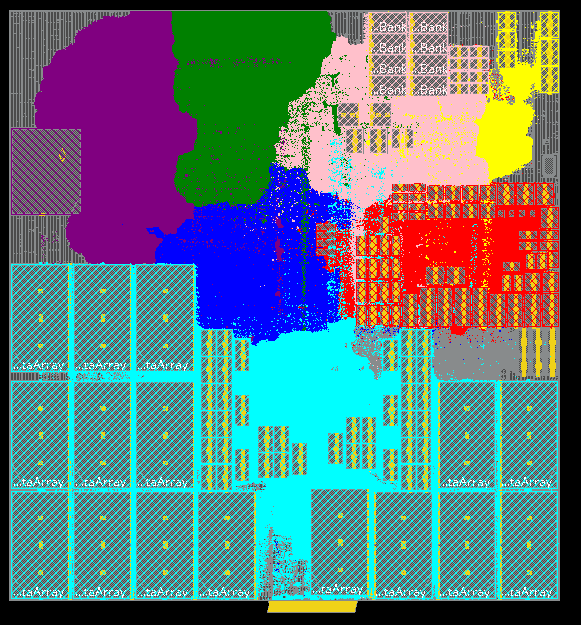
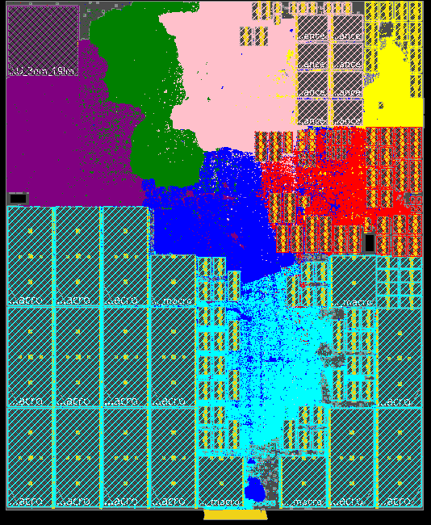
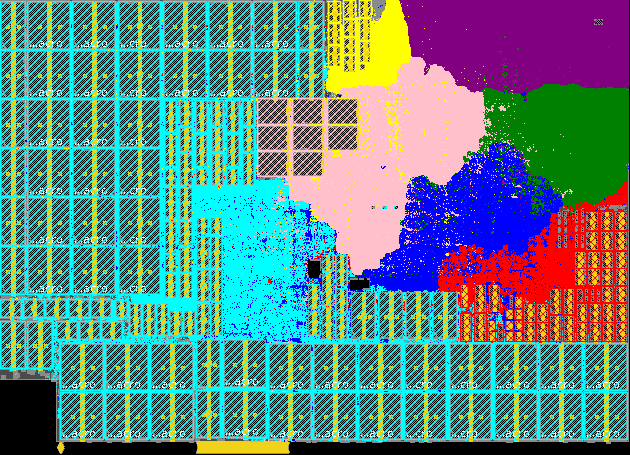

# Ampere Product Floorplan Gallery

Panthera configuration files use engineering code names for the SoC and core
being modeled. This gallery shows the core floorplans with the corresponding
Ampere product names.

## AmpereOne

- **SoC:** Siryn
- **Core:** Furiosa

See the [Furiosa microarchitecture notes](furiosa.md) for a detailed
description of this core.

## AmpereOne X

- **SoC:** Banshee
- **Core:** Ripley

## AmpereOne MX

- **SoC:** Rogue
- **Core:** Trinity

## AmpereOne Aurora

- **SoC:** Domino
- **Core:** Connor

