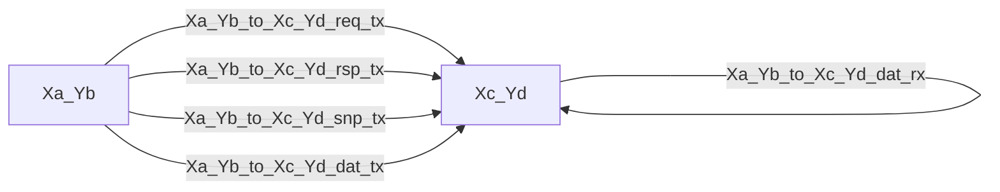

# SoC Model

The SoC (System on a Chip) portion of the Panthera model refers to the components required to build and simulate the
complete CPU outside the core. This includes mesh interconnect, home agents, system level cache, memory endpoints,
and so forth. This document gives a brief tour of those components, as well as information on how an SoC model is
configured and run.

## Common Elements

### CHI

Ampere server CPUs use the CHI messaging protocol to communicate between cores, caches, and memory. Thus CHI messages
and message channels are fundamental to the SoC model. CHI consists of four independent channel types carrying four
different packets: requests, responses, snoops, and data. In the model, each basic packet type is reflected as a
structure, defined in [mesh/chi/types.h](../../src/ampere/mesh/chi/types.h). There you'll find `Request`, `Response`,
`Snoop`, and `Data`, each a child of the generic `Transaction` type used throughout the model. You'll also find some
auxiliary structures used to help model some of the more complex fields of CHI packets, like the `NodeID`.

#### CHI Node Id

Every source and target in a CHI system is assigned a node id. This is required to route packets through the
interconnect. Since we use a 2-dimensional fabric with agents attached at the cross-points, our node ids (`NodeId` type)
are encoded into four coordinates: *x*, *y*, *port*, and *device*. *x* and *y* are simply the horizontal and vertical
location of the cross-point, while *port* indicates to which port of the cross-point the agent in question is attached
(typically there are two ports, but we can model more). Behind each port it is possible to connect more than one *device*
through a CHI mux called a CPX, and so there is also a *device* coordinate. A single device attached to a port with
no CPX will have device id 0. All packets contain a source id (`SrcId`) and destination id (`DstId`) to indicate where
they originated and where they are headed. Some packets contain additional `NodeId`s to refer to other participants in
a particular protocol.

#### CHI Opcodes

CHI opcodes, as well as other related enumerations, are defined in [mesh/chi/opcodes.tab](../../src/ampere/mesh/chi/opcodes.tab).
We use the Python table generator to write C++ definitions of these enumerations, along with helper functions and Python
code for visualization of event streams.

### Mesh Transactions

There is one more layer around the CHI structures to create the transactions used in the SoC model. While the goal
of the CHI types is to represent CHI as cleanly as possible, the types `MeshReq`, `MeshRsp`, `MeshSnp`, and
`MeshDat` are intended to carry the CHI packet payload along with any other data, behaviors, special constructors,
etc., that are specific to an Ampere performance model. Their definitions can be found in these files:

- [mesh/mesh_req.h](../../src/ampere/mesh/mesh_req.h)
- [mesh/mesh_rsp.h](../../src/ampere/mesh/mesh_rsp.h)
- [mesh/mesh_snp.h](../../src/ampere/mesh/mesh_snp.h)
- [mesh/mesh_dat.h](../../src/ampere/mesh/mesh_dat.h)

### Mesh Config

A mesh has some properties which are global. Rather than try to coordinate this global configuration information
among all the components of a mesh, we provide an abstract mesh configuration interface (`MeshConfigIfc`) which is
intended to be implemented by a single parent module, and inherited automatically by child modules.

The primary examples of global mesh config today are: (1) how to map addresses to (home) node ids; (2) the width of
the data channel.

So for example, the top-level SoC module can implement this interface and all cores and home nodes can call it to map a
physical address into a node id.

### Mesh Modules

The `MeshModule` class is a child of the generic `Module` class, but adds a port to the `MeshConfigIfc` as well as the
construction time code to find the implementor of this interface up the module hierarchy. If you have any module that
needs access to the global mesh config, it should be a child of `MeshModule` rather than `Module`.

### Mesh Devices

The `MeshDevice` class is another abstract interface needed for any mesh component which can be attached to a cross-
point (the `MeshNode` class). This is to aid in construction of an SoC, so that the top level module can create and
attach components to the mesh in a configurable way (that is, it doesn't have to know the complete mesh layout at
compile time). `MeshDevice` is intended to be used along with the polymorphic module machinery so that a mesh device
can be discovered at run time by name.

That means anything you want to attach to a mesh will likely be declared like this:

```cpp
class Core : public MeshModule, implements<Core, MeshDevice>
```

Now the SoC builder can find this device using the name "Core" and access its mesh port (see below) to connect it to
the mesh. Note, if the module needs to use a `(sc_core::sc_module_name, Clock*)` constructor, the following should be
used:

```cpp
class Core : public MeshModule, implements<Core, MeshDevice, poly_constructor_default, poly_constructor_clock>
```

### Mesh Ports

Since the CHI message channels are the common way for mesh components to talk to each other, it made sense to bundle
them together into a single object to make connection easier. This is the `MeshPort`. Every device which attaches to
the mesh must have a `MeshPort` (and the `get_mesh_port()` method of the `MeshDevice` interface must be implemented
to return that port). The `MeshPort` consists of 8 actual ports: 4 transmit and 4 receive ports, one for each channel
type (recall the types are request, response, snoop, and data).

Receive and transmit are abbreviated `rx` and `tx`, while the channels are abbreviated `req`, `rsp`, `snp`, and `dat`.
Thus a module that is communicating using a mesh port will have code that looks something like this:

```cpp
mesh_port->rx.req.take()
mesh_port->rx.rsp.take()
mesh_port->rx.snp.take()
mesh_port->rx.dat.take()

mesh_port->tx.req.put(pkt)
mesh_port->tx.rsp.put(pkt)
mesh_port->tx.snp.put(pkt)
mesh_port->tx.dat.put(pkt)
```

## Configuration

The SoC model is configured the same way as the core model, that is by using `.cfg` files filled with parameter
settings.

### Configuring the Fabric

The mesh itself (the two dimensional grid of cross-point routers) is simply configured with an *x* dimension, *y*
dimension, and the maximum number of device ports (non-routers) which can be attached to a single router. There is
no limit to this latter number in the model, to make it easier to play with complex configurations. For example, this
would create a 4x5 mesh with the option to attach up to 6 devices to each router.

    soc.mesh.size_x 4
    soc.mesh.size_y 5
    soc.mesh.devices 6

### Adding Devices

A mesh is not useful without anything attached! So to attach devices, we use the `devices` parameter of the top-level
SoC module. It is a JSON values parameter which is an array of device specifications.

Here's what it might look like for a small (2x1) mesh with only one core and one memory endpoint attached:

    soc.mesh.size_x 2
    soc.mesh.size_y 1
    soc.mesh.devices 2

    soc.devices [
        {
            "type": "Core",
            "position": [0, 0, 0, 0]
        },
        {
            "type": "Memory",
            "position": [1, 0, 0, 0]
        },
        {
            "type": "HomeNode",
            "position": [1, 0, 1, 0]
        }
    ]

You can see that each device has (at least) a "type" and a "position". The type name must be the name of a mesh
device, so in this example there would have to be classes declared as `implements<Core, MeshDevice>`,
`implements<Memory, MeshDevice>`, and `implements<HomeNode, MeshDevice>` built into the model. The position is a node id
written as a tuple: `[x, y, port, device]`. Here the core is attached to the router at `(0,0)` on its first port,
while the memory endpoint and home node are both attached to the router at `(1,0)` using ports `0` and `1`,
respectively.

The SoC builder creates an instance name for each device that is derived from type name. Basically it just lowers the
case of the name and adds a numeric suffix. In the above example, you'll have the names:

    soc.core_0
    soc.memory_0
    soc.homenode_0

So if you need to further configure the core (no doubt you will), it might look like:

    soc.core_0:cfg furiosa.cfg

If you want to use a different instance name from the type, you can use the "prefix" argument to do so:

```json
{ "type": "Memory", "position": [1, 0, 1, 0], "prefix": "external_memory" }
```

Instead of "memory_0", you'll get "external_memory_0". This can be useful when you have interchangeable types.

Panthera's supported memory endpoint is `Memory`. It models loaded memory latency from bandwidth/latency curves; see
the [Memory Model](model-memory.md) guide for its configuration and the retained `config/model/mc/` profiles.

### Communication

A lot of mesh configuration involves setting latency parameters for communication. For this, it is necessary to
understand how communication channels are named so you can access their parameters (the usual `latency`, `capacity`,
and so forth). Regular expressions are your friend here, so you can set many parameters in one go.

A `MeshNode` is named after its coordinate, and the channels in between mesh nodes are derived from coordinates as
well. The communication channel names are built like this:

    AxB_to_CxD_CHAN_DIR

where `(a,b)` is the coordinate of the first node, and `(c,d)` is the coordinate of the second node, `CHAN` is the
channel name (`req`, `rsp`, `snp`, or `dat`) and `DIR` is either `rx` or `tx`. Not all combinations of coordinates
are in use; because nodes are connected from *west* to *east* (lower *x* to higher *x*) and *south* to *north* (lower
*y* to higher *y*), you'll see names like "0x0_to_1x0" but not "1x0_to_0x0". This is okay because each mesh port
is bi-directional, so you can get at the `rx` and `tx` directions that way. In the *x* direction, `tx` means from
west to east (lower to higher), and `rx` means east to west (higher to lower). Similarly in the *y* direction, `tx`
means south to north (lower to higher) and `rx` means north to south (higher to lower). Diagrammatically:



Thus if you wanted to set the latency for requests going from node `(0,0)` to `(1,0)` to 2 cycles, you could do so as
follows:

    soc.mesh.X0_Y0_to_X1_Y0_req_tx.latency 2

Of course it's more common to have to set latencies for all channels symmetrically, and that's where the regular
expressions are useful. This will set the latency to 2 for all channels, both directions:

    ~soc\.mesh\.X0_Y0_to_X1_Y0_.*\.latency 2

Maybe you have to set a latency for *all* nodes in a large mesh. This sets all the routing latencies to 2:

    ~soc\.mesh\.X[0-9]+_Y[0-9]+_to_X[0-9]+_Y[0-9]+_.*\.latency 2

There are also mesh ports between a `MeshNode` and a `MeshDevice`, of course, and you can address those with a name
constructed like this:

    Xa_Yb_Pc_CHAN_DIR

Let's say the `Core` attached to the first mesh node needs some extra cycles to make a request into the mesh. It would
be configured like this:

    X0_Y0_P0_req_tx.latency 4

## The HomeNode

The `HomeNode` is the most complex component of the mesh outside of the core and memory endpoint (which are beyond
the scope of this document). Its job is to act as a point of coherence for the set of cache lines that "owns", to
manage a slice of the system level cache if configured to do so, and to generally orchestrate the CHI protocol between
requesters and responders.

A detailed description of `HomeNode` micro-architecture deserves its own document. But here is a short map to help you
find your way around the code:

| File | Description |
| ---- | ----------- |
| [home_node.h](../../src/ampere/mesh/home_node.h) | Module definition. |
| [home_node.cc](../../src/ampere/mesh/home_node.cc) | Implements all the input/output, as well as the `run()` function. |
| [home_node_tracker.h](../../src/ampere/mesh/home_node_tracker.h) | Defines the tracker, the primary structure managing requests. |
| [home_node_tracker.cc](../../src/ampere/mesh/home_node_tracker.cc) | Basic tracker routines, like allocation and deallocation. |
| [home_node_tracker_entry.h](../../src/ampere/mesh/home_node_tracker_entry.h) | Defines the contents of a tracker entry. |
| [home_node_tracker_fsm.h](../../src/ampere/mesh/home_node_tracker_fsm.h) | Defines the tracker FSM events and affiliated data. |
| [home_node_tracker_fsm.cc](../../src/ampere/mesh/home_node_tracker_fsm.cc) | Implements the tracker FSM; the meat of protocol management. |
| [snoop_filter.h](../../src/ampere/mesh/snoop_filter.h) | Defines the snoop filter class. |
| [snoop_filter.cc](../../src/ampere/mesh/snoop_filter.cc) | Implements lookup, refill, etc., for the snoop filter. |
| [slc.h](../../src/ampere/mesh/slc.h) | Defines a system level cache class. |
| [slc.cc](../../src/ampere/mesh/slc.cc) | Imlpements the system level cache class. |

## The Mesh Injector

The mesh injector acts like a vastly simplified core for the purpose of (of course) injecting traffic into the mesh. It
can be configured to run a traditional trace, or it can execute a simple program written in JSON format. When executing
code, the injector will obey all instruction and memory dependencies. It also models an L2 data cache so that cache
filtering and evictions will be relatively accurate. Otherwise it aims to commit one uop per cycle; it has no concept of
IPC today. The primary parameter used to limit its bandwidth into the mesh is the number of outstanding requests it is
allowed (called "max_outstanding_requests", naturally). Since the injector is intended to run memory intensive workloads,
its modeling of core IPC should be largely irrelevant (*NOTE: though we probably do want to implement some kind of
programmable IPC target at some point.*)

If you want to run with the mesh injector, you will need to instantiate it as a device with the name `MeshInjector`.
Then it can be configured to run a trace (and because its running real instructions, it needs a set of decoders):

    soc.meshinjector_0.source.is /path/to/trace.is.xz
    soc.meshinjector_0.source.decoders ["furiosa"]

### Injector Programs

If you want to run the injector with hand-written program, you need to change the source type and supply the
program:

    soc.meshinjector_0.source.type UopSourceProg
    soc.meshinjector_0.source.program {
        "code": [
            {"op": "STR_64_ldst_pos", "fields": {"imm12": 0, "Rn": 1, "Rt": 3}, "pa": 8192},
            {"op": "LDR_64_ldst_pos", "fields": {"imm12": 0, "Rn": 1, "Rt": 2}, "pa": 8192}
        ]
    }

In this case the program consists of only two instructions, a store followed by a load. The instructions are admittedly
a bit cryptic. But if you have seen an xlat file, such as [memory.xlat](../../src/ampere/decoders/furiosa/xlat/memory.xlat),
it should look passingly familiar. The "op" name maps to an instruction translation class, and the contents of the
"fields" object map to the values of the labeled fields. With these two pieces of information, you have a complete
ARM opcode. This seemed better than forcing the user to assemble an instruction into bytes without putting a large
burden on the injector to have to assemble from a string. But perhaps in the future this can be made cleaner. The
final field here, "pa" is the physical address, which cannot come from the instruction itself and so has to be
supplied separately.

#### Looping and Repeating

Some primitive mechanism are available for looping. First, to create a loop around the entire code block, you can
provide a loop count:

    program {
        "code": [
            {"op": "STR_64_ldst_pos", "fields": {"imm12": 0, "Rn": 1, "Rt": 3}, "pa": 8192},
            {"op": "LDR_64_ldst_pos", "fields": {"imm12": 0, "Rn": 1, "Rt": 2}, "pa": 8192}
        ]
        "loop": 1000
    }

Now the store and load will both execute 1,000 times in a loop.

It is also possible to repeat a single instruction:

    program {
        "code": [
            {"op": "LDP_64_ldstpair_post", "fields": {"imm7": 16, "Rn": 1, "Rt": 2, "Rt2": 3}, "pa": "A+"},
            {"op": "ADD_64_addsub_ext", "fields": {"imm3": 0, "Rd": 4, "Rn": 5, "Rm": 4, "option": 1}, "repeat": 100}
        ]
    }

In the above example, the load will execute, followed by 100 add instructions.

#### Generators

Instead of hard-coding physical addresses, you might want to generate them as streams or random addresses. That is
possible by adding a "generator", and using a new syntax in the "pa" field. Here is an example:

    soc.meshinjector_0.source.program {
        "generators": [
            {
                "name": "A",
                "type": "strided",
                "start": "0x20000",
                "stride": 64
            }
        ],
        "code": [
            {"op": "LDR_64_ldst_pos", "fields": {"imm12": 0, "Rn": 1, "Rt": 2}, "pa": "A+"},
            {"op": "LDR_64_ldst_pos", "fields": {"imm12": 0, "Rn": 1, "Rt": 2}, "pa": "A+"},
            {"op": "LDR_64_ldst_pos", "fields": {"imm12": 0, "Rn": 1, "Rt": 2}, "pa": "A+"}
        ]
    }

Multiple generators may be defined, but in this example there is only one. A generator has a name, and type, and
other parameters that relate to its type. This generator is named "A" and when you use the name "A" in the code, it
refers back to this generator. The syntax "A+" means to use the generator named "A" and advance it (i.e., move to
the next strided address). Thus this program will inject three loads with addresses `0x20000`, `0x20040`, and `0x20080`.

Using just the name "A" will obtain an address from the generator but not advance it; in this manner you can write
programs that have more than one operation referring to the same address.

At this time, the only other generator uses a random (uniform distribution). Its configuration might look like this:

    "generators": [
        {
            "name": "A",
            "type": "random",
            "start": "0x0",
            "stop": "0x10000000",
            "distribution": "uniform",
            "mask": "0x7",
            "seed": 1234
        }
    ]

You can supply a "stop" and "start" point to constrain the range, as well as a "mask". Masked bits will be forced
to zero, so in this example all addresses will be 8 byte aligned. You can also supply a "seed" to start off the
random number generator.

#### Parameters

It is possible to parametrize a program and supply values at run time. Wherever a number is expected, it should
be possible to write a string like "@parameter_name" which will introduce a parameter of that name that you can
set via a config file or the command line. You can also include a default value using a number suffix:
"@parameter_name:12".

For example, the block below acts just like the previous one except that some values can be supplied at run
time.

    "generators": [
        {
            "name": "A",
            "type": "random",
            "start": "@start_addr:0x0",
            "stop": "@stop_addr:0x10000000",
            "distribution": "uniform",
            "mask": "0x7",
            "seed": "@random_seed:1234"
        }
    ]

Programs are loaded down inside the uop source for a mesh injector, so their names will be in that object's
scope. This means your config settings might look something like:

    -sys.soc_0.meshinjector_0.source.start_addr 0x1000

This example used the generators block, but parameters are also possible in code. They are very useful for loop
and repeat counts.
