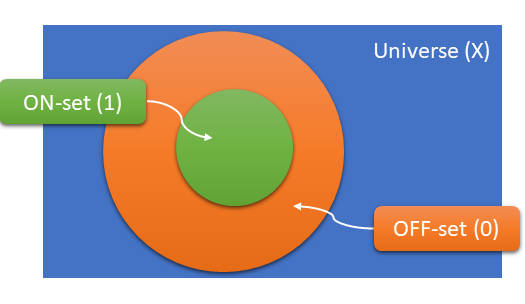

## Decode

**Decode** refers to the process of generating control signals from encoded signal, like a uop's _opcode_. For
example, maybe we want to know *is this an arithmetic uop?* or *does this uop have an immediate?* These questions are
essentially functions which map from an opcode to a truth value, and that's exactly how they're expressed in `xlat`: as
Python functions. `xlat` can then transform such functions into SystemVerilog.
 
#### Example

Below is a simple example of what such a function might look like.

**is_arithmetic.sv.py**:
```Python
import xlat

@xlat.scope(xlat.uops, inputs='opcode')
def is_arithmetic(uop):
    return uop.type == 'arithmetic'
```

Notice that this function has a Python _decorator_ called `scope`. The `scope` decorator serves a number of purposes,
the first of which is simply to mark this function as one that will be converted into logic. Technically it means that
the decorated function will be built into a `Generator`, and that's why this documentation will refer to this as a
_generator function_ (it is possible to create a `Generator` directly, but that's a more advance topic for later).
 
The second purpose is to define the set of objects on which the function should be applied. This is where the decorator
gets its name. In this case, that set is called `xlat.uops`, which is one of the "root sets" supplied by `xlat`. It
means, "the set of all known uops".
 
Thirdly, there are some optional arguments to `scope` to further control how the logic is generated. Here we see
`inputs='opcode'` because `xlat` has to know which input signal(s) will be used to distinguish uops which are
arithmetic versus those that aren't. The `inputs` argument can be a couple different kinds of things&mdash;in this case
a simple string means to use the attribute called `opcode` from each uop object.

##### Wait, Where Did These Uops Come From?

Indeed! This example is not yet complete. `xlat` defines a base class for uops, but does not itself define any. Let's
add a couple of uops into the code (in practice these would likely come from a separate module):

**is_arithmetic.sv.py**:
```Python
import xlat

class add(xlat.Uop):
    opcode = xlat.Signal('010')
    type = 'arithmetic'
    
class beq(xlat.Uop):
    opcode = xlat.Signal('100')
    type = 'branch'
    
@xlat.scope(xlat.uops, inputs='opcode')
def is_arithmetic(uop):
    return uop.type == 'arithmetic'
``` 

The base class of our two uops is `Uop`, and so now you probably have a sense for how the input set `xlat.uops`
is created: it is merely the list of all classes derived from `Uop`. These uops each have two attributes: `opcode`
which is a `Signal`, and `type` which encodes what kind of uop this is. For the most part, you can define whatever
attributes you like on the uops you create, they are _your_ objects. The only restriction from `xlat` is that any
attribute used in the `inputs` of a generator function must be a `Signal`. The reason will become obvious in a moment.

### Running `xlat`

Let's run `xlat` on the above input, like this (we'll use the `--stdout` switch for the moment; by default `xlat`
will generate a new file alongside each input file):

```shell
xlat is_arithmetic.sv.py --stdout
```

The basic operation is this:
 
1. For each generator function, sweep over the entire input set (e.g. uops) and pass each one to the function.
2. Use `inputs` to produce the input `Signal`s for each uop, and use the return value of the function as the output.
3. Place the inputs and output into a "truth table"; one row for each call to the function.
4. Minimize the truth table using `espresso`.
5. Convert the output of `espresso` into SystemVerilog.

In this example the truth table should look like this:

<table>
<tr><th>opcode</th><th>is_arithmetic</th></tr>
<tr><td>010</td><td>1</td></tr>
<tr><td>100</td><td>0</td></tr>
</table>

Unsurprisingly, then, the minimized logic finds the one bit that can distinguish the arithmetic uop from the
non-arithmetic:

```
package is_arithmetic;

function logic is_arithmetic(input logic [2:0] opcode);
  is_arithmetic = opcode[1];
endfunction

endpackage
```

### Scope Chains

Decoding functions are ubiquitous in logic, so it's important that they be minimal. One technique for creating minimal
functions is to take advantage of "don't care"s&mdash;the fact that the output of the function simply doesn't matter
for some inputs. Thus `xlat` deals not just with boolean logic, but with ternary logic: 0, 1, and X (don't-care). In
this forumation, 0 and 1 are often called the "OFF" set and the "ON" set, respectively. The Venn diagram below
illustrates how `xlat` conceives of the relationship between these sets when it's evaluating a generator function.



Here, the "universe" might be, say, the set of all uops, including those that we don't care about. The "OFF" set is the
set of uops which we do care about, but which do not have the property we're testing for. Finally the "ON" set is those
uops which we do care about and which _do_ have the property. In `xlat` this idea is conveyed by chaining scopes.

Let's change our example to a new function: "is this uop an indirect branch?" This new example will require a new uop
and two generators.

**is_indirect_branch.sv.py**:
```Python
import xlat

class add(xlat.Uop):
    opcode = xlat.Signal('010')
    type = 'arithmetic'
    
class beq(xlat.Uop):
    opcode = xlat.Signal('100')
    type = 'branch'
    branch_type = 'direct'
    
class br(xlat.Uop):
    opcode = xlat.Signal('110')
    type = 'branch'
    branch_type = 'indirect'
    
@xlat.scope(xlat.uops, inputs='opcode')
def is_branch(uop):
    return uop.type == 'branch'
    
@xlat.scope(is_branch)
def is_indirect_branch(uop):
    return uop.branch_type == 'indirect'
```

Here `is_branch` is defined in a similar way to `is_arithmetic` in the previous example. But notice that the
generator `is_indirect_branch` has a scope of `is_branch`&mdash;the previous generator! This means that only uops
which satisfy `is_branch` will even be considered by `is_indirect_branch`. This effectively defines our three sets:

1. The "universe" is all uops. Those which fail to satisfy the scope `is_branch` are don't-cares.
2. The "OFF" set is uops which satisfy `is_branch` but which do not satisfy `is_indirect_branch`.
3. The "ON" set is uops which satisfy both `is_branch` and `is_indirect_branch`.

The truth table will look like:

<table>
<tr><th>opcode</th><th>is_indirect_branch</th></tr>
<tr><td>010</td><td>X</td></tr>
<tr><td>100</td><td>0</td></tr>
<tr><td>110</td><td>1</td></tr>
</table>

and the resulting logic:

```
package is_indirect_branch;

function logic is_branch(input logic [2:0] opcode);
  is_branch = opcode[2];
endfunction


function logic is_indirect_branch(input logic [2:0] opcode);
  is_indirect_branch = opcode[1];
endfunction

endpackage
```

Look how simple `is_indirect_branch` is: it only tests the middle bit of the opcode. How can it tell a `br` apart
from an `add`? Really, it can't. The big assumption of chained scope, or any scope, is that the function will never
be passed an input which does not satisfy it. Since this is an important assumption to test, `xlat` provides an option
to include a check in the generated logic called `--scope-check`. `--scope-check` takes an argument which is the name
of a macro to guard the check, since it may not apply to all use cases (e.g. synthesis).
minimization.

```shell
xlat is_arithmetic.sv.py --stdout --scope-check TESTING
```

gives us:

```
function logic is_indirect_branch(input logic [2:0] opcode);
  is_indirect_branch = opcode[1];

`ifdef TESTING
  if (is_branch(opcode) !== 1) is_indirect_branch = 'x;
`endif
endfunction
```

By returning X we enable lint checkers can catch problems if desired.

#### Turning Off Generation

In the output above, `xlat` produced a function for both `is_branch` and `is_indirect_branch`. Usually this would be
desired, because something like `is_branch` would be used to steer a uop to the branch unit where `is_indirect_branch`
can operate under the safe assumption that all incoming uops are branches. But sometimes it's convenient to defined
a generator function that is *only* used to provide a scope, and does not produce any output. If that were the case
for `is_branch`, we could add the `do_not_generate` option: 

```Python
@xlat.scope(xlat.uops, inputs='opcode', do_not_generate=True)
def is_branch(uop):
    return uop.type == 'branch'
```

### Inputs

TBD.

### Default Output

TBD.
